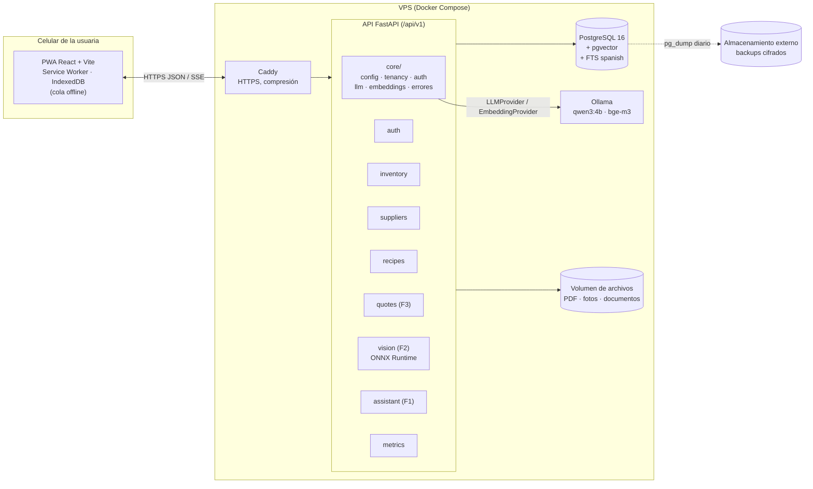
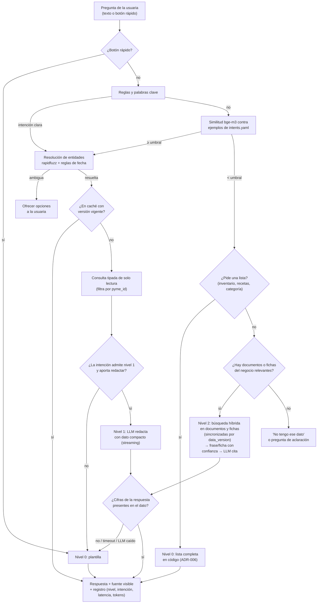

# Arquitectura — Cáterin

- Estado: propuesta inicial (9-nov-2026), se ajusta a medida que avanzan T01–T11.
- Fuente de las decisiones: `AGENTS.md` (secciones 3 y 4) y los ADR en `docs/adr/`.

## 1. Visión general

Cáterin es un monolito modular: **una API FastAPI**, **una base PostgreSQL con pgvector**, **un servidor Ollama** para el LLM y los embeddings, y **una PWA React** que la usuaria abre desde el celular. Todo corre con Docker Compose en un VPS pequeño, detrás de Caddy (HTTPS).

Se eligió así porque la usuaria objetivo necesita algo barato y fácil de mantener: un solo servidor, una sola base de datos y ningún servicio de pago obligatorio (ver ADR-001).

## 2. Diagrama de componentes



Proveedor externo de LLM: opcional, se activa por `.env` y pasa por la misma interfaz `LLMProvider`. Está apagado por defecto (ver `docs/SECURITY.md`, datos personales).

## 3. Componentes y responsabilidades

| Componente | Responsabilidad | No hace |
|------------|-----------------|---------|
| PWA (`apps/web`) | Pantallas mobile-first, caché de catálogos, cola de escrituras sin red, cámara | Cálculos de negocio definitivos (los muestra, no los decide) |
| `core/config` | Configuración por variables de entorno (`pydantic-settings`) | Leer archivos de configuración sueltos |
| `core/tenancy` | Dependencia central que obtiene `pyme_id` del token y filtra todas las consultas | — |
| `core/llm` | Interfaz `LLMProvider` (Ollama por defecto, externo opcional), timeouts, *streaming* | Ningún módulo importa un SDK de LLM fuera de aquí |
| `core/embeddings` | Interfaz `EmbeddingProvider` (`bge-m3`) y reranker opcional | — |
| `modules/auth` | Registro, login JWT, roles (dueña, colaboradora) | — |
| `modules/inventory` | Insumos y stock (libro de movimientos) | — |
| `modules/imports` | Importación de insumos y precios desde CSV/Excel (vista previa, confirmación, deshacer) | — |
| `modules/suppliers` | Proveedores, precios por presentación, importación de listas, interfaz `PriceSource` | Scraping sin ADR aprobado |
| `modules/recipes` | Recetas, líneas de receta, costo calculado | — |
| `modules/quotes` | Pedidos, extractor de pedidos, cálculo de insumos, comparación de precios, PDF | Dejar que el LLM calcule |
| `modules/vision` | Inferencia ONNX, conteo editable, registro de producción y correcciones | Entrenar (eso vive en `ml/vision`) |
| `modules/assistant` | Enrutador de intenciones, consultas tipadas de solo lectura, plantillas, RAG, caché | Text-to-SQL libre, agente por defecto |
| `modules/metrics` | Encuesta, tiempos de cotización, latencia por nivel del asistente | — |
| `ml/` | Entrenamiento de visión, benchmarks, evaluaciones (`ml/evals`) | Servir en producción |

> **Nota:** `modules/suppliers` no aparece en la estructura del `README.md`. Se propone separarlo de `inventory` porque los precios y la comparación de proveedores son la base de F3 y tienen su propia lógica de importación. Si el equipo prefiere no separarlo, se fusiona con `inventory` sin cambiar el modelo de datos.

## 4. Límites de módulos

Cada módulo de `apps/api/app/modules/<módulo>/` sigue la misma forma:

```
router.py     # rutas HTTP; solo valida, llama al servicio y responde
schemas.py    # modelos Pydantic de entrada y salida
service.py    # lógica de negocio; la única API pública del módulo hacia otros módulos
```

El acceso a datos va dentro de `service.py` con la sesión de tenant (`core/tenancy.TenantDB`), que filtra por `pyme_id` sola. Se crea un `repository.py` solo si un módulo crece lo suficiente para justificarlo.

Reglas:

1. Un módulo solo importa `service.py` y `schemas.py` de otro módulo.
2. Dependencias permitidas (sin ciclos):
   - `inventory`, `suppliers` y `recipes` dependen solo de `core`.
   - `quotes` depende de `recipes`, `inventory` y `suppliers`.
   - `assistant` depende de los servicios de lectura de `inventory`, `recipes`, `suppliers` y `quotes`.
   - `vision` depende de `recipes` (producto final) e `inventory` (registro de producción).
   - `metrics` recibe eventos de todos y no es dependencia de nadie.
   - `portal` (ADR-007) depende de `quotes` (mismo motor de cotización) y de `auth` (emitir la sesión del cliente).
3. Los modelos SQLAlchemy viven en `app/db/models/` (uno por agregado) para que Alembic los vea todos. Cada módulo usa solo los suyos.
4. La aritmética de negocio (cantidades, costos, IVA, redondeos) vive en funciones puras sin acceso a la base, en `recipes/costing.py` y `quotes/calculator.py`, para testearla aislada (ver ADR-002).

## 5. Flujos por funcionalidad

### F1 — Asistente de gestión (por niveles)

Detalle y justificación en ADR-005.



### F2 — Conteo de productos con foto

1. La usuaria saca una foto desde la PWA. El navegador la reduce (lado mayor ≤ 1280 px) y la envía con `POST /api/v1/vision/count`.
2. La API valida el tipo y el tamaño, **elimina los metadatos EXIF** (ubicación GPS) y guarda la imagen.
3. El preprocesamiento redimensiona a la entrada del modelo (384×384 en la medición inicial) y ONNX Runtime ejecuta RF-DETR en CPU.
4. El postprocesamiento filtra por umbral de confianza y cuenta por clase. Cada clase corresponde a una `Receta` marcada como producto final.
5. La PWA muestra el conteo y las cajas. La usuaria corrige con botones **+/−** o cambia el producto.
6. Al confirmar se crea un `ProduccionRegistrada` con el conteo detectado y el confirmado, la versión del modelo y las detecciones. La diferencia queda como dato para reentrenar (`ml/vision`).
7. Sin red, la foto queda en la cola local y se procesa al reconectar. Mientras tanto la usuaria puede registrar el conteo a mano.

Latencia medida solo de la inferencia: p50 de 169 ms en i5-8250U, con imagen aleatoria y sin decodificar ni postprocesar. La latencia de punta a punta se mide en T06.

### F3 — Cotización automatizada

```mermaid
flowchart LR
    A["Pedido<br/>texto libre · lista · formulario"] --> X["Extractor qwen3:4b<br/>JSON schema → Pydantic"]
    X -->|no valida 2 veces| F["Formulario manual"]
    X --> T["Tabla editable:<br/>la usuaria confirma"]
    F --> T
    T --> M["Resolver productos<br/>contra recetas (rapidfuzz)"]
    M --> Q["Cantidad de insumos<br/>Decimal + merma"]
    Q --> S["Descontar stock disponible"]
    S --> L["Lista de compras<br/>(presentaciones enteras)"]
    L --> P["Comparar precios<br/>por proveedor"]
    P --> C["Cotización: costo, margen,<br/>IVA, total CLP + supuestos"]
    C --> PDF["PDF para el cliente final"]
```



- El LLM solo entra en el paso del extractor. Todo lo que va desde "Resolver productos" en adelante es código determinista (ADR-002).
- `POST /orders/extract` **no guarda nada**: devuelve la tabla editable. El pedido se crea recién cuando la usuaria confirma (`POST /orders`), así no quedan datos personales de pedidos descartados.
- Recetas: se resuelven con `core/matching.py` (rapidfuzz, `token_set_ratio` sin tildes ni palabras vacías). Se asocia solo con puntaje ≥ 85 y 10 puntos de ventaja; si no, se ofrecen sugerencias. Fechas: `core/dates.py`, con reglas.
- Para el **costo** se usa la presentación vigente más barata por unidad base. Para la **lista de compras**, la presentación con menor total a pagar (para 630 g conviene 1 bolsa de 1 kg y no un saco de 25 kg).
- **Precio al cliente:** costo del producto × (1 + margen) / cantidad, redondeado a pesos. Subtotal = precio unitario × cantidad (el PDF cuadra a la vista). IVA sobre el neto.
- Si falta algún precio, la cotización se guarda como incompleta y **no** se genera el PDF hasta completarla.
- Cada cotización guarda la versión de precios usada (snapshot de los `PrecioInsumo`), los supuestos (merma, margen, IVA, redondeo) y quién la generó.
- El tiempo de la cotización se mide desde que se abre el pedido hasta que se genera el PDF (T09).

**Portal de clientes (ADR-007).** El cliente final se registra con el enlace de la pyme y cotiza con la misma pantalla y el mismo motor, pero solo ve el precio al cliente. Su pedido queda `customer_draft` (la pyme no lo ve) hasta que lo envía (`requested`). La dueña lo ve en Pedidos y lo acepta (`confirmed`, cotización `accepted`) o lo rechaza con un mensaje.

## 6. Estrategia offline (resumen)

Detalle en ADR-004.

| Funciona sin red | Se encola y sincroniza | Requiere red |
|------------------|------------------------|--------------|
| Ver insumos, stock (con la hora del último dato), recetas, proveedores y precios cacheados | Ajustes de stock, borradores de pedido, registro manual de producción, fotos pendientes de conteo | Asistente, extracción con LLM, cálculo y PDF de cotización, inferencia de visión, login inicial |

## 7. Despliegue y costo mensual estimado

### 7.1 Servicios en Compose

`caddy`, `api`, `web` (archivos estáticos servidos por Caddy en producción), `postgres` (imagen `pgvector/pgvector:pg16`) y `ollama`. En desarrollo se agrega Vite con recarga en caliente.

### 7.2 Dimensionamiento de memoria (estimación, no medido en servidor)

| Proceso | RAM estimada | Base de la estimación |
|---------|--------------|-----------------------|
| Ollama con `qwen3:4b` (Q4, contexto 4k) | 3 a 4 GB | Pesos de ~2.5 GB más caché KV. El 3.2 GB de `bench_results.json` **no es confiable** (bug de RAM, ver ADR-003) |
| Ollama con `bge-m3` | 1.2 a 2.5 GB | 568M parámetros; depende de la cuantización que use Ollama |
| API + ONNX Runtime (RF-DETR Nano) | 0.6 a 1 GB | ONNX de 115 MB más el proceso Python |
| PostgreSQL | 0.5 a 1 GB | Pocas pymes y pocos datos en el MVP |
| Caddy y sistema | 0.5 GB | — |
| **Total** | **~6 a 9 GB** | 8 GB queda justo; **16 GB es lo cómodo** |

CPU: 4 vCPU como mínimo y 8 recomendados, ya que el LLM se lleva casi toda la CPU mientras genera. Las vCPU de un VPS pueden ser más lentas o más rápidas que el i5-8250U de referencia, así que los presupuestos de latencia **se vuelven a medir en el VPS elegido** (T11).

### 7.3 Costo mensual (rango referencial, a verificar en T11)

| Ítem | Rango estimado | Nota |
|------|----------------|------|
| VPS de 4 a 8 vCPU y 16 GB | USD 15 a 45 / mes | Varía mucho según proveedor y región; cotizar al contratar |
| Dominio | USD 1 a 2 / mes | Prorrateo de un dominio `.cl` o `.com` |
| Backups en almacenamiento de objetos | USD 1 a 5 / mes | Pocos GB al inicio |
| LLM externo (opcional) | USD 0 por defecto | Solo si se activa; se paga por uso |
| **Total** | **USD ~20 a 50 / mes** | Por instancia; varias pymes comparten un servidor (multi-tenant) |

Estas cifras **no se han verificado** con cotizaciones reales. T11 las reemplaza con precios concretos, con fecha y fuente.

## 8. Observabilidad

- Logs JSON estructurados con `request_id` y `pyme_id`, sin datos personales ni prompts completos en nivel INFO.
- `GET /api/v1/health/live` (proceso vivo) y `GET /api/v1/health/ready` (base de datos, Ollama y modelo ONNX cargado).
- `MetricaEvento` registra la latencia por nivel del asistente, el tiempo de cotización y la latencia de visión. El panel de métricas (T09) lee de ahí.
