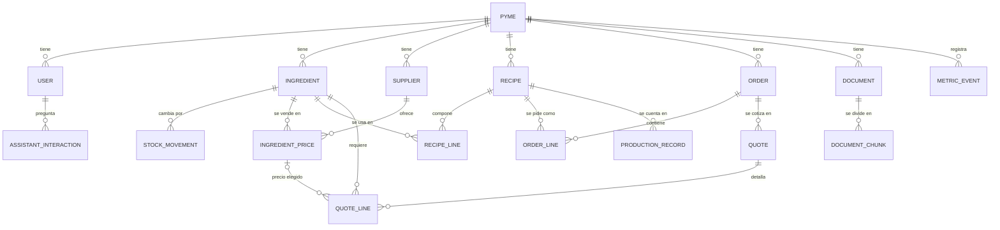

# Modelo de datos — Cáterin

- Estado: propuesta inicial (9-nov-2026). Se implementa en T02 con SQLAlchemy 2.x y Alembic.
- Nombres de tablas y columnas en inglés (convención de código); entre paréntesis, el nombre de negocio en español.

## 1. Diagrama de entidades

## 2. Columnas comunes

Todas las tablas de negocio llevan:

| Columna | Tipo | Regla |
|---------|------|-------|
| `id` | UUID | Generado por la API (UUIDv7 si la librería lo permite, para ordenar por tiempo; si no, v4) |
| `pyme_id` | UUID, FK → `pyme.id`, NOT NULL, indexado | Multi-tenancy (sección 4) |
| `created_at`, `updated_at` | `timestamptz` | En UTC; se muestran en `America/Santiago` |
| `created_by` | UUID, FK → `user.id`, nullable | Trazabilidad |

`pyme` es la única tabla de negocio sin `pyme_id`.

## 3. Entidades

Leyenda: **[MVP]** son las entidades exigidas en `AGENTS.md` (sección 7.1). **[propuesta]** son las de soporte que el diseño necesita y que se confirman en T02.

### Pyme (`pyme`) [MVP]
| Campo | Tipo | Nota |
|-------|------|------|
| `name` | text | Nombre de fantasía |
| `rut` | text, nullable | Opcional; validar dígito verificador si se ingresa |
| `commune` | text, nullable | Comuna (p. ej. Temuco) |
| `default_waste_pct` | numeric(5,2), default 0 | Merma por defecto; la fija la usuaria |
| `default_margin_pct` | numeric(5,2), nullable | Margen por defecto. **Sin valor inventado**: lo define la usuaria |
| `vat_pct` | numeric(5,2), default 19.00 | IVA de Chile |
| `prices_include_vat` | bool, default true | Si sus precios de compra se ingresan con IVA |

### Usuario (`user`) [MVP]
| Campo | Tipo | Nota |
|-------|------|------|
| `email` | citext, único global | Login |
| `full_name` | text | |
| `password_hash` | text | Argon2id |
| `role` | enum `owner` \| `collaborator` | Dueña / colaboradora |
| `is_active` | bool | |

Una usuaria pertenece a una sola pyme en el MVP. Si se necesitan varias, se agrega una tabla de membresías con una migración.

### Insumo (`ingredient`) [MVP]
| Campo | Tipo | Nota |
|-------|------|------|
| `name` | text | Único por pyme (`UNIQUE(pyme_id, lower(name))`) |
| `base_unit` | enum `g` \| `ml` \| `unit` | Unidad base (sección 5) |
| `stock_qty` | numeric(14,3) | Saldo cacheado; se actualiza en la misma transacción que el movimiento |
| `min_stock_qty` | numeric(14,3), nullable | Para "¿qué me falta?" |
| `waste_pct` | numeric(5,2), nullable | Sobrescribe la merma de la pyme |
| `density_g_per_ml` | numeric(8,4), nullable | Solo si se necesita convertir masa ↔ volumen; nunca se asume |
| `category` | text, nullable | |
| `is_active` | bool | Borrado lógico |

### Movimiento de stock (`stock_movement`) [propuesta]
Libro de movimientos que solo crece. Es la fuente de verdad del stock y lo que permite sincronizar sin conflictos desde la cola offline (ADR-004).

| Campo | Tipo | Nota |
|-------|------|------|
| `ingredient_id` | FK | |
| `delta_qty` | numeric(14,3) | Positivo entra, negativo sale (unidad base) |
| `reason` | enum `purchase` \| `consumption` \| `adjustment` \| `waste` \| `production` \| `import` | |
| `reference_type`, `reference_id` | text, UUID, nullable | P. ej. cotización o producción |
| `client_op_id` | UUID, nullable, `UNIQUE(pyme_id, client_op_id)` | Idempotencia de escrituras offline |
| `occurred_at` | timestamptz | Cuándo pasó (puede ser anterior a `created_at` si venía offline) |

### Proveedor (`supplier`) [MVP]
| Campo | Tipo | Nota |
|-------|------|------|
| `name` | text | Único por pyme |
| `phone`, `email`, `website` | text, nullable | Datos de la empresa proveedora |
| `delivery_days` | smallint[] , nullable | 1 = lunes … 7 = domingo |
| `notes` | text, nullable | |

### Precio de insumo (`ingredient_price`) [MVP]
Los precios **no se editan, se versionan**: un cambio de precio crea un registro nuevo y marca el anterior como no vigente. Así una cotización antigua sigue apuntando al precio que usó.

| Campo | Tipo | Nota |
|-------|------|------|
| `ingredient_id`, `supplier_id` | FK | |
| `package_label` | text | Presentación, p. ej. "saco 25 kg" |
| `package_qty` | numeric(14,3) | Cantidad de la presentación en unidad base (25000 g) |
| `price_clp` | numeric(12,0) | Precio de la presentación en CLP sin decimales |
| `includes_vat` | bool | |
| `price_date` | date | Fecha del precio (se muestra en la cotización) |
| `source` | enum `manual` \| `csv` \| `excel` \| `price_list` \| `price_source` | |
| `import_batch_id` | UUID, nullable | Para deshacer una importación |
| `is_current` | bool | Un solo vigente por `(pyme_id, ingredient_id, supplier_id, package_label)` (índice parcial único) |

El precio por unidad base se calcula en código cuando se necesita (`price_clp / package_qty`, en `Decimal`) y no se guarda.

### Receta (`recipe`) [MVP]
| Campo | Tipo | Nota |
|-------|------|------|
| `name` | text | Único por pyme |
| `yield_qty` | numeric(10,3) | Rendimiento, p. ej. 12 |
| `yield_unit` | enum `unit` \| `g` \| `ml` | P. ej. 12 unidades (una docena) |
| `is_final_product` | bool | Si se vende o se cuenta por foto |
| `vision_class` | text, nullable, único por pyme | Clase del detector que corresponde a este producto |
| `notes` | text, nullable | |
| `version` | int | Sube con cada cambio de líneas |

### Línea de receta (`recipe_line`) [MVP]
| Campo | Tipo | Nota |
|-------|------|------|
| `recipe_id`, `ingredient_id` | FK | `UNIQUE(recipe_id, ingredient_id)` |
| `qty` | numeric(14,3) | En unidad base del insumo, para el rendimiento de la receta |
| `waste_pct` | numeric(5,2), nullable | Sobrescribe la del insumo |

Sub-recetas (una receta que usa otra, p. ej. "masa"): **fuera del MVP**. Si aparecen en los datos reales, se evalúan en T04.

### Pedido (`order`) [MVP]
| Campo | Tipo | Nota |
|-------|------|------|
| `customer_name` | text | Dato personal mínimo |
| `customer_contact` | text, nullable | Teléfono o correo; opcional |
| `event_date` | date, nullable | |
| `guests` | int, nullable | |
| `status` | enum `draft` \| `confirmed` \| `delivered` \| `cancelled` | |
| `source` | enum `text` \| `list` \| `form` | |
| `raw_text` | text, nullable | Texto original. Puede tener datos personales: se borra a los N días (configurable, ver SECURITY) |
| `extraction` | jsonb, nullable | Salida del extractor (modelo, versión del prompt, JSON) para evaluación |

### Línea de pedido (`order_line`) [propuesta]
| Campo | Tipo | Nota |
|-------|------|------|
| `order_id`, `recipe_id` | FK | `recipe_id` nullable mientras no se resuelva |
| `requested_name` | text | Lo que escribió el cliente ("empanaditas de pino") |
| `qty` | numeric(10,3) | |
| `unit` | enum `unit` \| `dozen` \| `g` \| `ml` \| `portion` | Se normaliza en código |

### Cotización (`quote`) [MVP]
| Campo | Tipo | Nota |
|-------|------|------|
| `order_id` | FK | |
| `version` | int | Una cotización nueva por recálculo; no se sobrescribe |
| `status` | enum `draft` \| `sent` \| `accepted` \| `rejected` | |
| `price_snapshot` | jsonb | ids y valores de los `ingredient_price` usados (la "versión de precios") |
| `assumptions` | jsonb | Merma, margen, IVA, reglas de redondeo y stock descontado |
| `ingredients_cost_clp` | numeric(12,0) | Costo de insumos |
| `margin_pct` | numeric(5,2) | |
| `net_clp`, `vat_clp`, `total_clp` | numeric(12,0) | |
| `pdf_path` | text, nullable | |
| `calc_version` | text | Versión del motor de cálculo (para reproducir) |

### Línea de cotización (`quote_line`) [MVP]
| Campo | Tipo | Nota |
|-------|------|------|
| `quote_id`, `ingredient_id` | FK | |
| `required_qty` | numeric(14,3) | Necesario con merma (unidad base) |
| `stock_used_qty` | numeric(14,3) | Descontado del stock |
| `to_buy_qty` | numeric(14,3) | Faltante |
| `ingredient_price_id` | FK, nullable | Precio elegido; null si no hay proveedor con precio |
| `packages_to_buy` | int | Presentaciones enteras (redondeo hacia arriba) |
| `unit_price_clp` | numeric(12,0) | Precio de la presentación |
| `subtotal_clp` | numeric(12,0) | |
| `price_date` | date | |
| `alternatives` | jsonb | Otras ofertas comparadas (proveedor, precio, fecha) |
| `note` | text, nullable | P. ej. "sin proveedor con precio" |

### Producción registrada (`production_record`) [MVP]
| Campo | Tipo | Nota |
|-------|------|------|
| `recipe_id` | FK | Producto final contado |
| `detected_qty` | int, nullable | Lo que contó el modelo (null si fue manual) |
| `confirmed_qty` | int | Lo que confirmó la usuaria |
| `image_path` | text, nullable | Foto sin EXIF |
| `model_version` | text, nullable | Del `models.lock.yaml` |
| `detections` | jsonb, nullable | Cajas, clases y confianza; base para reentrenar |
| `was_corrected` | bool | `detected_qty != confirmed_qty` o clase cambiada |
| `client_op_id` | UUID, nullable | Idempotencia offline |

### Documento (`document`) [MVP]
| Campo | Tipo | Nota |
|-------|------|------|
| `filename` | text | |
| `mime_type` | text | PDF, XLSX, CSV, TXT |
| `sha256` | text | `UNIQUE(pyme_id, sha256)`: evita indexar dos veces lo mismo |
| `size_bytes` | int | |
| `storage_path` | text | |
| `index_status` | enum `pending` \| `indexed` \| `failed` | |

### Fragmento de documento (`document_chunk`) [propuesta]
| Campo | Tipo | Nota |
|-------|------|------|
| `document_id` | FK, `ON DELETE CASCADE` | |
| `ordinal` | int | Posición dentro del documento |
| `text` | text | |
| `tsv` | tsvector (columna generada, `to_tsvector('spanish', text)`), índice GIN | Búsqueda de texto completo |
| `embedding` | vector(1024), índice HNSW (coseno) | **Dimensión fija en la migración** |
| `embedding_model` | text | P. ej. `BAAI/bge-m3` |
| `embedding_version` | text | Revisión del `models.lock.yaml` |
| `meta` | jsonb | Página, hoja o fila de origen (para citar) |

### Interacción del asistente (`assistant_interaction`) [propuesta]
Cumple la regla de trazabilidad: cada respuesta guarda las consultas usadas y sus fuentes.

| Campo | Tipo | Nota |
|-------|------|------|
| `user_id` | FK | |
| `question` | text | Se borra a los N días (configurable) |
| `intent` | text, nullable | |
| `level` | smallint | 0, 1, 2 (3 si se activa) |
| `router_score` | numeric(5,4), nullable | Similitud del enrutador |
| `entities` | jsonb | Entidades resueltas |
| `queries` | jsonb | Funciones invocadas y sus parámetros |
| `sources` | jsonb | Tablas o fragmentos citados |
| `cache_hit` | bool | |
| `fallback_reason` | text, nullable | `llm_timeout`, `llm_down`, `numbers_mismatch`… |
| `llm_model` | text, nullable | |
| `tokens_out` | int, nullable | |
| `latency_ms`, `first_token_ms` | int | |

### Evento de métrica (`metric_event`) [MVP]
| Campo | Tipo | Nota |
|-------|------|------|
| `user_id` | FK, nullable | |
| `kind` | enum `survey` \| `quote_timing` \| `assistant_latency` \| `vision_latency` \| `manual_baseline` | |
| `value_num` | numeric, nullable | Estrellas, segundos o milisegundos |
| `payload` | jsonb | Detalle por tipo |

### Movimiento de caja (`cash_movement`) [propuesta, a confirmar]
La intención `get_cash_summary` ("¿cómo va la caja?") necesita algún dato de finanzas. Se propone lo mínimo: ingresos y egresos manuales, más el ingreso que se puede crear al aceptar una cotización. **No es contabilidad ni facturación SII**, que quedan fuera de alcance. El equipo confirma en T02 si entra al MVP.

| Campo | Tipo | Nota |
|-------|------|------|
| `kind` | enum `income` \| `expense` | |
| `amount_clp` | numeric(12,0) | Siempre positivo |
| `category` | text | |
| `occurred_on` | date | |
| `reference_type`, `reference_id` | nullable | P. ej. cotización aceptada |

### Versión de datos (`data_version`) [propuesta]
`(pyme_id, domain)` → `version` (bigint). `domain` ∈ `inventory`, `recipes`, `suppliers`, `orders`, `cash`, `documents`. Cada escritura relevante lo incrementa en la misma transacción; la caché del asistente lo usa en su clave (ADR-005).

## 4. Reglas de multi-tenancy

1. **Toda tabla de negocio lleva `pyme_id` NOT NULL.**
2. El `pyme_id` sale **solo del token** (JWT) mediante la dependencia central `core/tenancy.get_tenant()`. Nunca se lee del cuerpo ni de la URL.
3. Los repositorios reciben una `TenantSession` que agrega `WHERE pyme_id = :tenant` a toda consulta (con `with_loader_criteria` de SQLAlchemy). Escribir filtros a mano está prohibido.
4. **FK compuestas** `(pyme_id, x_id)` → `(pyme_id, id)` en las relaciones entre tablas de negocio, para que la base impida que un registro apunte a otro de una pyme distinta, aunque falle el código.
5. Las restricciones `UNIQUE` incluyen `pyme_id` (p. ej. dos pymes pueden tener un insumo "harina").
6. Defensa en profundidad (a evaluar en T03): Row Level Security de Postgres con `SET app.pyme_id` por transacción.
7. Tests obligatorios: con dos pymes sembradas, cada endpoint de lectura y escritura demuestra que la pyme A no ve, no modifica y no referencia datos de B (T03 y cada tarea que toque datos).

## 5. Unidades, cantidades y moneda

### Unidades
- **Unidades base:** `g` (masa), `ml` (volumen), `unit` (unidades contables). Todo se guarda en unidad base.
- **Conversiones fijas** (en código, `core/units.py`): kg = 1000 g, L = 1000 ml, docena = 12 unidades, cc = 1 ml.
- **Masa ↔ volumen:** solo si el insumo tiene `density_g_per_ml`. Si falta, el sistema avisa y pide el dato; no asume densidad 1.
- **Unidades caseras** ("taza", "cucharada", "pizca"): no se convierten automáticamente en el MVP. El extractor las marca y la usuaria las resuelve en la tabla editable.

### Cantidades
- `numeric(14,3)` y `Decimal` en Python, nunca `float`.
- Insumo necesario = Σ (cantidad de línea × unidades pedidas / rendimiento) × (1 + merma%).
- La compra se redondea **hacia arriba** a presentaciones enteras.

### Moneda
- **CLP sin decimales**: `numeric(12,0)` y `Decimal` cuantizado a `Decimal("1")`.
- Los cálculos intermedios van con precisión completa; se redondea **una vez por línea** (subtotal) y luego en los totales, con `ROUND_HALF_UP`.
- IVA: 19% (`pyme.vat_pct`) sobre el neto redondeado. Si los precios de compra incluyen IVA, el neto se obtiene en código según `includes_vat`.
- **Las reglas de redondeo son una propuesta.** El equipo las confirma con una emprendedora real antes de cerrar T05 (pregunta abierta en T05).

## 6. Retención de datos

| Dato | Retención propuesta | Motivo |
|------|---------------------|--------|
| `order.raw_text`, `assistant_interaction.question` | 90 días (configurable) | Pueden tener datos personales; sirven para evaluar |
| Fotos de producción | Mientras sirvan para reentrenar; borrables por la usuaria | Sin personas ni metadatos de ubicación |
| Cotizaciones, precios, movimientos | Indefinida | Trazabilidad del negocio |
